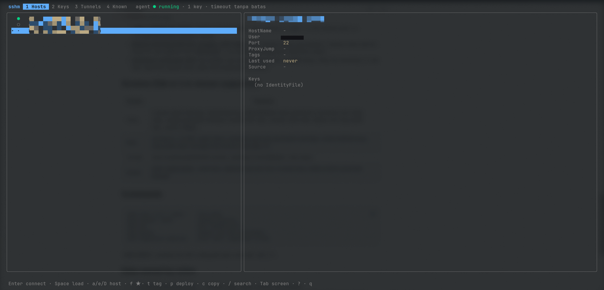

# sshm

A personal TUI for managing SSH, written in Go with Bubble Tea.
`~/.ssh/config` remains the source of truth for hosts; `sshm` invokes the
`ssh`, `ssh-add`, `ssh-agent`, `ssh-keygen`, and `ssh-copy-id` binaries and
**never stores passphrases**.

## Install

### Requirements

- The release binaries support Linux and macOS 12 or later on amd64 (x86_64)
  and arm64 (aarch64/Apple Silicon).
- Bash, `curl`, and standard command-line utilities, including `sha256sum`
  on Linux or `shasum` on macOS for checksum verification.
- Internet access to GitHub and a published release with binaries and checksums.
- OpenSSH tools to use sshm's SSH features.

### Install the latest release

No Go compiler or sudo is required for the default installation:

    curl -fsSL https://raw.githubusercontent.com/ragam20/ssh-manager/main/install.sh | bash

The installer downloads the latest stable release, verifies its SHA-256
checksum, and installs the executable at `~/.local/bin/sshm`.

If `~/.local/bin` is not on your `PATH`, add this line to `~/.bashrc` for
Bash or `~/.zshrc` for Zsh. For a Bash login shell, use `~/.bash_profile`:

    export PATH="$HOME/.local/bin:$PATH"

Run that line in the current terminal as well, or open a new terminal. Then
check the installation and launch sshm:

    sshm version
    sshm doctor
    sshm

`sshm doctor` reports the local SSH environment and any setup issues.

### Update

Replace the installed binary with the latest stable release:

    sshm update

The command verifies the download before replacing the running executable
through an atomic rename.

If your version predates these built-in commands, rerun the installation
command above once the latest release includes them. Reuse your original
`PREFIX` if you installed to a custom location.

### Uninstall

Remove the installed executable after confirming its path:

    sshm uninstall

Use `sshm uninstall --yes` to skip the prompt in scripts. This command works
offline.

Uninstall preserves sshm configuration, state, backups, and all files in
`~/.ssh`, including SSH keys.

Run the built-in commands as the user who owns the executable and its
`bin` directory. For package manager installations, use the package manager
to update or uninstall.

### Custom installation prefix

Set `PREFIX` on the `bash` side of the pipeline to install the executable
under `$PREFIX/bin`:

    curl -fsSL https://raw.githubusercontent.com/ragam20/ssh-manager/main/install.sh | PREFIX="$HOME/apps/sshm" bash

For this example, add `$HOME/apps/sshm/bin` to your `PATH` instead of
`$HOME/.local/bin`. The destination must be writable by your user.
`sshm update` and `sshm uninstall` use the location of the running executable
automatically.

### Build from source

Requires Git, Go 1.22 or newer, Make, and internet access to download Go modules:

    git clone https://github.com/ragam20/ssh-manager.git
    cd ssh-manager
    make install

This builds and installs to `~/.local/bin`. Configure `PATH` as above, then run
`sshm version` and `sshm doctor`. Source builds report the version recorded in
[`internal/cli/VERSION`](internal/cli/VERSION).
To update from source, run `git pull --ff-only` followed by `make install`
inside the checkout. To remove the executable, run `make uninstall`.

To install the release binary from a local checkout, run `sh install.sh`.

### Troubleshooting

- **`sshm: command not found`:** add the selected prefix's `bin` directory to
  `PATH`. For the default prefix, try `~/.local/bin/sshm version` directly.
- **Release download fails (for example, HTTP 404):** check network access and
  whether a release exists with the binary for your platform and `SHA256SUMS`.
  If no release is available yet, build from source.
- **Checksum verification fails:** the installer exits without replacing the
  installed binary. Retry the download; if it still fails, report the release
  issue rather than bypassing verification.

## Screens (Tab or 1-4; mouse supported)

| Screen | Features |
|---|---|
| Hosts | Connect (auto-load key), load/unload key, add/edit/delete hosts (preserves comments and config order, creates automatic backups), favorites ★, tags, recently used order, deploy and copy public keys, search (`#tag`) |
| Keys | List keys in `~/.ssh`, agent status, weak-key and loose-permission warnings, create ed25519 keys, copy public keys, set agent key timeout (`ssh-add -t`) |
| Tunnels | Save local/remote/SOCKS tunnels, start/stop (ControlMaster), view status |
| Known | Audit `known_hosts`: weak keys, duplicate keys per host, revoked keys; delete entries (automatic backup) |

## Commands

    sshm list [-n] [--json]     list hosts
    sshm connect <host>         connect directly
    sshm env                    eval "$(sshm env)"
    sshm doctor                 inspect the SSH environment
    sshm completion bash|zsh    print shell completion script

`SSHM_CONFIG` overrides the SSH config path (also used with `ssh -F`).

## Data owned by sshm

- `~/.config/sshm/state.json` — favorites, tags, history, tunnels, key timeouts
- `~/.local/state/sshm/backups/` — backups of config and known_hosts before changes (20 most recent)

## Code layout

    cmd/sshm/             thin entry point
    internal/cli/         non-interactive commands and completion
    internal/tui/         Bubble Tea model (model, input, actions, form, view)
    internal/sshconfig/   parser and writer for ~/.ssh/config
    internal/agent/       ssh-agent / ssh-add
    internal/keys/        key inspection, listing, and creation
    internal/knownhosts/  parser, audit, and deletion
    internal/tunnel/      tunnel definitions and control
    internal/store/       state.json
    internal/doctor/      SSH environment checks
    internal/clipboard/   copy (wl-copy/xclip/xsel/pbcopy, OSC 52 fallback)
    internal/fsutil/      atomic writes and backups
    internal/sshcmd/      ssh arguments and execution
    internal/paths/       file locations

## Release versioning

Versions use `YYYY.MM.DD.N`, for example `2026.11.19.0`. Start with `.0`
on each release date and increment the last number for each additional
release on that date. Local builds and GitHub Releases embed the same version.

Update `internal/cli/VERSION` and commit it before tagging the release.
For example, to tag and publish a commit that contains `2026.11.19.1`:

    git tag v2026.11.19.1
    git push origin v2026.11.19.1

The release workflow checks the tag against `VERSION` before publishing.

## Screenshot

